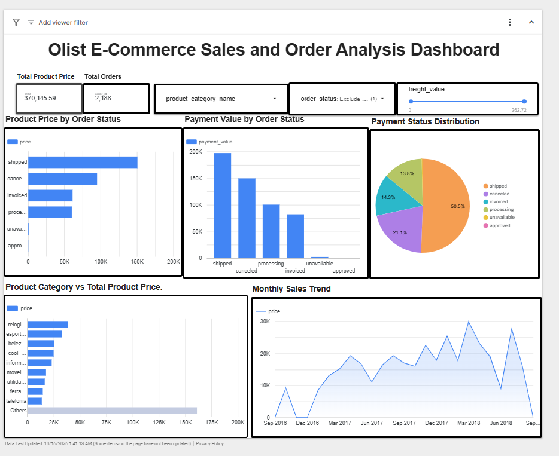

# Olist E-Commerce Sales and Order Analysis Dashboard

An end-to-end data analytics and visualization project using the Brazilian E-Commerce Public Dataset by Olist. The project combines Python/pandas data preparation, SQL examples, and an interactive Google Looker Studio dashboard.

## Dashboard preview



**Live dashboard:** [Open the Google Looker Studio report](https://datastudio.google.com/s/npWRSXkiVbY)

## Project objectives

- Summarize total item-price value and distinct order count.
- Compare summed product prices across order statuses and product categories.
- Explore monthly product-price trends over purchase time.
- Provide filters for order status, product category, and freight value.
- Document data preparation and important aggregation limitations.

## Tools used

- **Python and pandas:** inspect and analyze the consolidated CSV.
- **Google Colab:** original notebook/data-preparation workflow.
- **Google Sheets:** data source connected to the dashboard.
- **Google Looker Studio:** scorecards, bar charts, pie chart, time-series chart, and interactive controls.
- **SQL:** example queries for summary KPIs and category/status trends.

## Dashboard components

- Total Product Price scorecard (`SUM(price)`).
- Total Orders scorecard (`COUNT(DISTINCT order_id)`).
- Product Price by Order Status.
- Payment Value by Order Status (interpret cautiously; joined rows may repeat payment values).
- Order Status Distribution.
- Product Category vs Total Product Price.
- Monthly Product Price Trend.
- Product-category and order-status filters, plus freight-value range control.

## Repository contents

```text
olist-ecommerce-sales-order-analysis/
├── README.md
├── requirements.txt
├── data/
│   ├── olist_combined_dataset.csv
│   └── README.md
├── notebooks/
│   └── data_preparation_colab.ipynb
├── src/
│   └── analyze_dataset.py
├── sql/
│   └── analysis_queries.sql
├── reports/
│   ├── tables/                 # generated CSV summaries
│   └── charts/                 # generated PNG charts
├── dashboard/
│   ├── dashboard-link.txt
│   └── screenshots/
├── docs/
│   ├── data-dictionary.md
│   └── methodology-and-limitations.md
└── report/
    └── project_report.pdf
```

## Run the Python analysis

Use Python 3.10+ from the repository root.

```bash
python -m pip install -r requirements.txt
python src/analyze_dataset.py
```

The script reads `data/olist_combined_dataset.csv` and writes summary CSV files to `reports/tables/` and chart images to `reports/charts/`.

## Dataset source and attribution

The dataset is derived from the [Brazilian E-Commerce Public Dataset by Olist on Kaggle](https://www.kaggle.com/datasets/olistbr/brazilian-ecommerce). Review the source dataset's license and attribution requirements before redistributing the CSV.

## Data interpretation notes

- The consolidated table is at item/order-join grain; one order can appear on multiple rows.
- Use `COUNT(DISTINCT order_id)` to count unique orders.
- `SUM(price)` is the sum of item prices in the joined rows and should not automatically be called net revenue.
- `payment_value` may be repeated after joining payment-level and item-level records. Validate it before making financial conclusions.
- The supplied dashboard screenshot includes an active order-status filter, so its displayed KPI values may not represent unfiltered totals.
- The chart titled “Monthly Sales Trend” is more precisely a monthly product-price trend unless the metric is validated as revenue.

## Project report

See [`report/project_report.pdf`](report/project_report.pdf) for the academic report, including workflow, chart descriptions, observations, limitations, and references.
